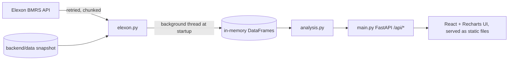

# WindDesk: UK Wind Forecast Evaluator

Web app for a UK utility's day-ahead power buying team. Using only Elexon BMRS national wind data it answers:

1. **Which wind forecast did we actually have when we had to decide?**
2. **How accurate has that forecast been, and how much cover does that imply?**

**Live app** <ADD LIVE LINK>  

## Brief to implementation
| Requirement in the brief | Where it is met |
|---|---|
| Latest forecast available at decision time (D-1) | `analysis.at_cutoff`, "Decision day" tab: latest WINDFOR run published at or before the cutoff (default 09:00 UTC on D-1; selectable) |
| Quantify forecast accuracy | "Accuracy" tab: MAE, RMSE, bias, MAPE, P90/P99, by hour, wind level, horizon, skill vs naive benchmark |
| Decisions made in January 2026 | Delivery days 2 Jan to 1 Feb 2026 (each decided the day before, 1 to 31 Jan) |
| Actuals: FUELHH, fuelType WIND, `startTime`, `generation` | `elexon.fetch_raw` (`settlementDateFrom/To`, `fuelType=WIND`) |
| Forecasts: WINDFOR `startTime`, `publishTime`, `generation` | `elexon.fetch_raw` (`publishDateTimeFrom/To`), all publish vintages kept |
| National wind from Elexon only | No other data sources anywhere |
| React frontend, Python backend, Docker | `frontend/` (React), `backend/` (FastAPI), `Dockerfile` |
| Deploy on Vercel or Heroku | Vercel (free Hobby plan): `vercel.json` + `api/index.py`. Container hosts (Heroku, Render) also supported via `Dockerfile` / `heroku.yml` |
| README: files, how to start, deployed link | This file |
| AI usage disclosed | Above |

## Understanding the data (verified against Elexon's API)
- **FUELHH** actuals are half-hourly; **WINDFOR** forecasts are **hourly**. Evaluation is therefore hourly: actual = mean of the two half-hours (hours missing a half-hour are excluded and reported on the Data quality tab).
- WINDFOR is published about 8 times a day (roughly 02:30, 04:30, 07:30, 09:30, 11:30, 15:30, 18:30, 22:30 UTC), each run reaching about 66 hours ahead. Rows for hours already past at publish time are dropped.
- Elexon describes WINDFOR as peak wind generation while FUELHH is average outturn, so some forecast bias may come from definition rather than weather. Worth knowing when reading the bias figure.
- **Cutoff is an assumption.** The brief says decisions are made one day before delivery but not the exact time. The default is 09:00 UTC on D-1; the cutoff selector lets the client set their real gate closure.
- All timestamps UTC (January is GMT, so UK local time is identical).

## Design
React 18 + TypeScript + Tailwind CSS v4 with a shadcn-style structure (`@/` alias, `components.json`, `src/components/ui`). The liquid-glass and metal buttons and the works-wheel are third-party shadcn-style components adapted for this product (changes are marked `WindDesk:` in the source). Dark, high-contrast data-product UI. Space Grotesk and Inter are bundled locally (no external requests, works under the CSP). Tabular numerals for all figures, custom chart tooltips, skeleton loaders, and an SVG wind-field header that respects reduced-motion settings.

## Features
- **Landing page:** full-screen Three.js hero (turbines, wind streamlines, dusk terrain), an interactive cutoff explainer, a live-data chart and counters, feature cards that deep-link into the dashboard, method notes and FAQ. Routes are hash-based (`#app`, `#app/<tab>`, `#day=YYYY-MM-DD`), so it stays a pure static site.
- **Closing scene (ThreeUI Sylva, living-green):** a Three.js world with moss, ferns, pollen and a butterfly, with its copy rewritten for WindDesk (`Read the wind before you buy`, 31 delivery days, 744 hours). It mounts only when scrolled near, and its buttons navigate the app (dashboard, accuracy tab, sections).
- **Month browser:** a 3D wheel of all 31 delivery days (each card is a small forecast-vs-actual chart built from the real data); click or press Enter to open that day. Phones get a card grid instead.
- **Decision day:** 24 hourly periods, forecast at cutoff with publish time, P10-P90 range from errors known before that day, CSV export.
- **Procurement cover calculator:** extra MWh to buy at a chosen confidence (illustrative, flat demand).
- **Accuracy:** metrics above plus a skill score against a naive benchmark (actual 48 hours earlier).
- **Forecast revisions:** how one target hour's forecast changed over successive runs, cutoff marked.
- **Data quality:** missing actuals, targets with no forecast at cutoff, publish range.

## Files
```
backend/elexon.py          Elexon client (retries, chunking, cache), hourly alignment, snapshot load/save, demo data
backend/analysis.py        pure functions: cutoff selection, metrics, bands, procurement, quality
backend/main.py            FastAPI app: /api/health, decision, decision.csv, procurement, accuracy, horizon, revisions, quality, series
backend/snapshot.py        one-off script that stores the January data in backend/data/ (commit it)
api/index.py               Vercel serverless entrypoint (wraps backend/main.py)
vercel.json, requirements.txt, .python-version   Vercel build and runtime config
backend/test_*.py          pytest: analysis logic, API behaviour, security headers (25 tests)
frontend/src/api.test.js   vitest unit tests
.env.example               documented environment variables (placeholders only)
backend/ruff.toml          lint config
frontend/src/              React + TypeScript (Vite, Tailwind v4, Recharts): App, Hero, Decision, MonthBrowser, Accuracy, Revisions, Quality, api.js
frontend/src/landing/      Landing.tsx, CutoffExplainer.tsx, hooks.tsx (live stats, reveal, counters)
frontend/src/scene/windScene.js, WindScene.tsx   Three.js hero scene (lazy-loaded; pauses off-screen; static frame for reduced motion)
frontend/src/Root.tsx      hash router: landing vs dashboard
frontend/src/components/ui shadcn-style components: aero-hero.tsx, liquid-glass-button.tsx (LiquidButton, MetalButton), works-wheel.tsx, button.tsx
frontend/components.json, tsconfig.json   shadcn and TypeScript configuration
scripts/build_sylva_html.py  reproducible copy-only tailoring of the ThreeUI scene HTML
scripts/probe_elexon.py    live probe of the two Elexon endpoints
scripts/check_contract.py  compares the endpoints/parameters this app uses with Elexon's official OpenAPI spec
docs/                      video scripts and submission checklist
Dockerfile, docker-compose.yml, heroku.yml, .github/workflows/ci.yml
```


## How to start
Data source order: committed snapshot in `backend/data/`, otherwise a live Elexon fetch (1 to 3 minutes), or `DEMO_MODE=1` synthetic data (bannered in the UI).

    # 1. (recommended, once) store the real data so the app starts instantly
    cd backend && pip install -r requirements.txt && python snapshot.py && cd ..
    # 2. run with Docker
    docker compose up --build            # http://localhost:8000

Without Docker: `cd backend && uvicorn main:app --reload`, then `cd frontend && npm i && npm run dev` (http://localhost:5173).  
Tests and lint: `cd backend && pytest && ruff check .` and `cd frontend && npm run typecheck && npm test` (CI runs all of these plus the frontend build; needs Node 22+).

## Deploy on Vercel (free Hobby plan)
    npm install -g vercel
    vercel login
    vercel deploy --prod --yes
Vercel builds the React app (`frontend/`) as static files and runs the FastAPI backend as a Python function (`api/index.py`).
On a cold start the function loads the committed snapshot (`backend/data/`) on the first request, so it never needs to call Elexon at runtime.
Python functions are limited to 500 MB per Vercel's docs; this app's dependencies are far below that.

## Deploy on a container host instead (optional, paid on Heroku)
    heroku create && heroku stack:set container && git push heroku main
Heroku has no free tier (Eco dynos are $5/month). `Dockerfile` also works on Render and similar hosts.

## Security and verification notes
- Read-only app: no accounts, database or user uploads. Responses carry security headers (CSP, nosniff, frame deny) and API responses are not cached.
- All query inputs are validated (422 on bad dates, hours, demand, confidence); the CSV filename is built from the validated date only.
- Dependencies audited with `pip-audit` and `npm audit` (no known vulnerabilities at the time of the last run); re-run before submitting.
- Rendering was checked in headless Chromium at 1440, 768 and 390 px widths (no horizontal overflow, no console or network errors). Not verified: live Elexon fetch, real phones/Safari, deployment. Check these yourself before recording the video.

## Data licence
Contains BMRS data © Elexon Limited copyright and database right (subject to Elexon's BMRS Data Licence Terms).

## ThreeUI Sylva integration
- `frontend/src/vendor/threeui/` holds the three small component files from `@designcodeio/threeui` 1.2.0 (MIT) with two small marked `WindDesk:` edits in `LandingPages.js` and `pageTypography.js` (the accessible title says WindDesk; the blank initial iframe document is not customised, which would violate the strict CSP); `frontend/public/landing-pages/` holds the scene HTML and its assets. The package's 73 KB shared stylesheet is not imported (it styles the whole library); the two rules this scene needs are in `style.css`.
- The HTML is a single file with inline scripts, so `/landing-pages/*` (and only that path) gets its own CSP (`script-src 'unsafe-inline'`, `frame-ancestors 'self'`) in `backend/main.py` and `vercel.json`. Every other path keeps the strict policy with no inline scripts.
- The copy is changed by `python scripts/build_sylva_html.py`, which verifies the canonical file's SHA-256 and requires each replacement to match exactly once.
- `frontend/src/components/ui/hive.tsx` is a fragment-shader background (supplied source, tinted to the brand palette, paused off-screen) used as the dashboard loading panel.

## Browser notes
The liquid-glass button's refraction uses `backdrop-filter: url(#svg-filter)`, which only Chromium browsers render; in Safari and Firefox the button falls back to a flat transparent style and stays fully usable. The Month wheel needs a pointer or keyboard; touch phones get the card grid.

The hero needs WebGL; without it (or if it fails) the page shows a static gradient with an SVG wind field. With `prefers-reduced-motion` the scene renders a single still frame.

## Operations and security
- **Configuration:** see `.env.example`. No secret, key or token exists in this project; everything is optional. `DEMO_MODE` is refused when `VERCEL_ENV` or `APP_ENV` is `production`, so synthetic data can never be served live.
- **Headers:** one policy module (`backend/security.py`) drives the API server and `vercel.json` (a test fails if they diverge). Strict CSP with no inline scripts or `eval`, HSTS, nosniff, no-referrer, Permissions-Policy, COOP/CORP, frame denial. The only relaxed policy is for `/landing-pages/*` (the self-hosted 3D scene), which may be framed only by this site.
- **API:** read-only `GET`s, validated and length-limited inputs, no CORS (same origin only), rate limiting per client IP, generic error messages (details go to server logs only), API docs disabled.
- **Caching:** content-hashed assets are immutable for a year; HTML is always revalidated; API data is cached for 5 minutes; health is never cached.
- **Verify a deployment:** `python scripts/verify_deployment.py https://your-site` runs the header, caching, stale-build, asset-integrity and API checks (it exits non-zero on any failure).
- **Scaling note:** the rate limiter and its counters live in each server instance. On Vercel, add the platform firewall rules for global limits.

## Limitations
- Error bands use only errors known before the delivery day; the earliest days fall back to the whole window and the UI says so.
- Procurement figures are illustrative (flat demand), not trading advice.
