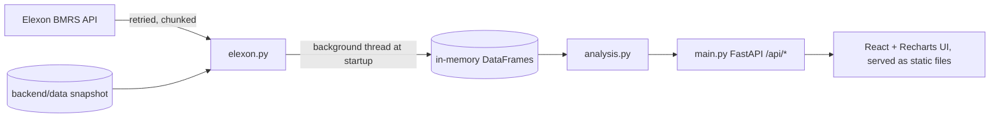

# WindDesk: UK Wind Forecast Evaluator

Web app for a UK utility's day-ahead power buying team. Using only Elexon BMRS national wind data it answers:

1. **Which wind forecast did we actually have when we had to decide?**
2. **How accurate has that forecast been, and how much cover does that imply?**

**Live app:** <ADD HEROKU LINK>  
**AI disclosure:** this project was built with the help of Claude (Anthropic) as an AI coding assistant. I reviewed and tested the code.

## Brief to implementation
| Requirement in the brief | Where it is met |
|---|---|
| Latest forecast available at decision time (D-1) | `analysis.at_cutoff`, "Decision day" tab: latest WINDFOR run published at or before the cutoff (default 09:00 UTC on D-1; selectable) |
| Quantify forecast accuracy | "Accuracy" tab: MAE, RMSE, bias, MAPE, P90/P99, by hour, wind level, horizon, skill vs naive benchmark |
| Decisions made in January 2026 | Delivery days 2 Jan to 1 Feb 2026 (each decided the day before, 1 to 31 Jan) |
| Actuals: FUELHH, fuelType WIND, `startTime`, `generation` | `elexon.fetch_raw` (`settlementDateFrom/To`, `fuelType=WIND`) |
| Forecasts: WINDFOR `startTime`, `publishTime`, `generation` | `elexon.fetch_raw` (`publishDateTimeFrom/To`), all publish vintages kept |
| National wind from Elexon only | No other data sources anywhere |
| React frontend, Python backend, Docker | `frontend/` (React), `backend/` (FastAPI), `Dockerfile` |
| Deploy on Vercel or Heroku | Heroku container deploy, see below |
| README: files, how to start, deployed link | This file |
| AI usage disclosed | Above |

## Understanding the data (verified against Elexon's API)
- **FUELHH** actuals are half-hourly; **WINDFOR** forecasts are **hourly**. Evaluation is therefore hourly: actual = mean of the two half-hours (hours missing a half-hour are excluded and reported on the Data quality tab).
- WINDFOR is published about 8 times a day (roughly 02:30, 04:30, 07:30, 09:30, 11:30, 15:30, 18:30, 22:30 UTC), each run reaching about 66 hours ahead. Rows for hours already past at publish time are dropped.
- Elexon describes WINDFOR as peak wind generation while FUELHH is average outturn, so some forecast bias may come from definition rather than weather. Worth knowing when reading the bias figure.
- **Cutoff is an assumption.** The brief says decisions are made one day before delivery but not the exact time. The default is 09:00 UTC on D-1; the cutoff selector lets the client set their real gate closure.
- All timestamps UTC (January is GMT, so UK local time is identical).

## Design
Dark, high-contrast data-product UI. Space Grotesk and Inter are bundled locally (no external requests, works under the CSP). Tabular numerals for all figures, custom chart tooltips, skeleton loaders, and an SVG wind-field header that respects reduced-motion settings.

## Features
- **Decision day:** 24 hourly periods, forecast at cutoff with publish time, P10-P90 range from errors known before that day, CSV export.
- **Procurement cover calculator:** extra MWh to buy at a chosen confidence (illustrative, flat demand).
- **Accuracy:** metrics above plus a skill score against a naive benchmark (actual 48 hours earlier).
- **Forecast revisions:** how one target hour's forecast changed over successive runs, cutoff marked.
- **Data quality:** missing actuals, targets with no forecast at cutoff, publish range.

## Files
```
backend/elexon.py          Elexon client (retries, chunking, cache), hourly alignment, snapshot load/save, demo data
backend/analysis.py        pure functions: cutoff selection, metrics, bands, procurement, quality
backend/main.py            FastAPI app: /api/health, decision, decision.csv, procurement, accuracy, horizon, revisions, quality, series
backend/snapshot.py        one-off script that stores the January data in backend/data/ (commit it)
backend/test_*.py          pytest: analysis logic, API behaviour, security headers (25 tests)
frontend/src/api.test.js   vitest unit tests
.env.example               documented environment variables (placeholders only)
backend/ruff.toml          lint config
frontend/src/              React (Vite + Recharts): App, Hero, Decision, Accuracy, Revisions, Quality, api.js
scripts/probe_elexon.py    live probe of the two Elexon endpoints
scripts/check_contract.py  compares the endpoints/parameters this app uses with Elexon's official OpenAPI spec
docs/                      video scripts and submission checklist
Dockerfile, docker-compose.yml, heroku.yml, .github/workflows/ci.yml
```


## How to start
Data source order: committed snapshot in `backend/data/`, otherwise a live Elexon fetch (1 to 3 minutes), or `DEMO_MODE=1` synthetic data (bannered in the UI).

    # 1. (recommended, once) store the real data so the app starts instantly
    cd backend && pip install -r requirements.txt && python snapshot.py && cd ..
    # 2. run with Docker
    docker compose up --build            # http://localhost:8000

Without Docker: `cd backend && uvicorn main:app --reload`, then `cd frontend && npm i && npm run dev` (http://localhost:5173).  
Tests and lint: `cd backend && pytest && ruff check .` and `cd frontend && npm test` (CI runs all of these plus the frontend build; needs Node 22+).

## Deploy (Heroku, container stack)
    heroku create && heroku stack:set container && git push heroku main

## Security and verification notes
- Read-only app: no accounts, database or user uploads. Responses carry security headers (CSP, nosniff, frame deny) and API responses are not cached.
- All query inputs are validated (422 on bad dates, hours, demand, confidence); the CSV filename is built from the validated date only.
- Dependencies audited with `pip-audit` and `npm audit` (no known vulnerabilities at the time of the last run); re-run before submitting.
- Rendering was checked in headless Chromium at 1440, 768 and 390 px widths (no horizontal overflow, no console or network errors). Not verified: live Elexon fetch, real phones/Safari, deployment. Check these yourself before recording the video.

## Data licence
Contains BMRS data © Elexon Limited copyright and database right (subject to Elexon's BMRS Data Licence Terms).

## Limitations
- Error bands use only errors known before the delivery day; the earliest days fall back to the whole window and the UI says so.
- Procurement figures are illustrative (flat demand), not trading advice.
